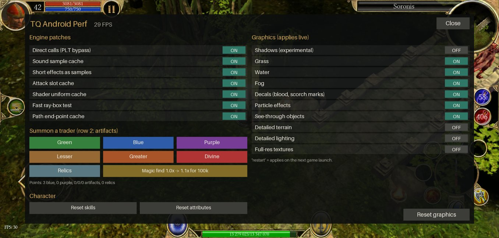
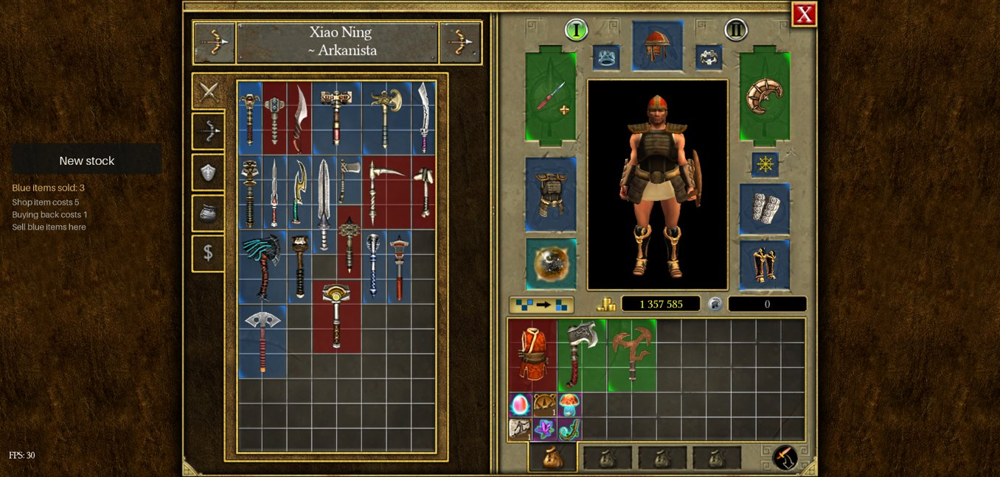
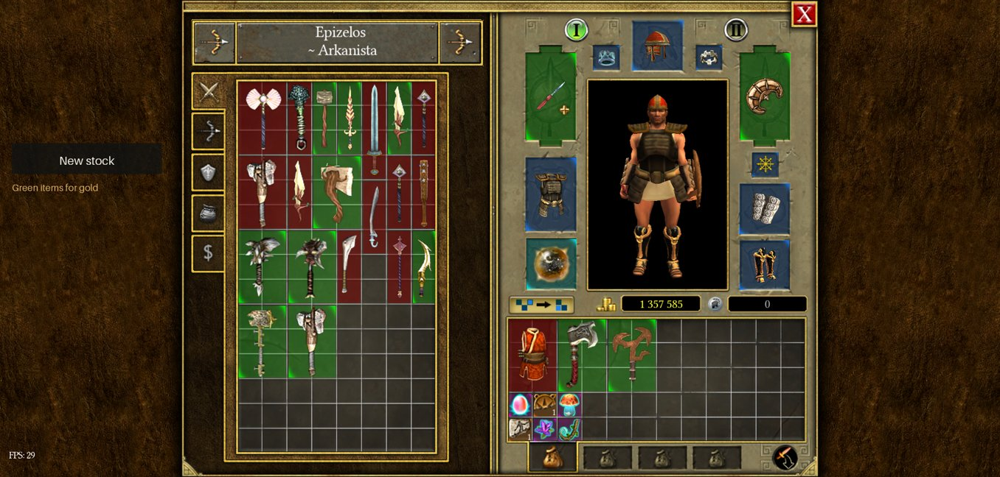
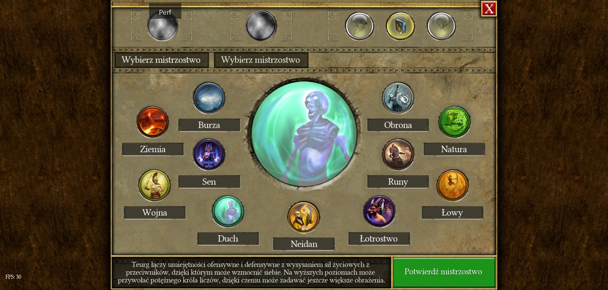

# TQ Traders & Respec for Titan Quest on Android

An unofficial, open-source Magisk module for Titan Quest on Android (single-player). It adds a small in-game menu where you can summon a trader next to your character (colored items, artifacts, or relics and charms), make any merchant restock, buy a permanent magic find bonus with gold, and reset your skills or attributes. It runs on its own or as an add-on of [tq-android-perf](https://github.com/SlopPort/tq-android-perf). No game files are modified or distributed.









**[Download v1.4 from GitHub Releases](https://github.com/SlopPort/tq-traders/releases/latest)**

## What it does

- **Summon a trader** next to your character, in seven kinds:
  - **Green:** green (Rare) items for normal gold prices.
  - **Blue:** blue (Epic) items, paid with blue items you sell to it.
  - **Purple:** purple (Legendary) items, paid with purple items you sell to it.
  - **Lesser, Greater, Divine:** artifacts of that tier, paid with artifacts of the same tier you sell to it. Each artifact is made through its formula, so it gets a random completion bonus like a crafted one.
  - **Relics:** complete relics and charms with a completion bonus, paid with complete relics and charms you sell to it.
- **Magic find**, bought with gold, permanent per character: from 1.1x up to 2.5x. Each loot roll gets extra rolls and the best result is kept.
- **Restock** any merchant's stock, including the game's normal merchants.
- **Reset skills:** all skill and mastery points come back, and you choose both masteries again.
- **Reset attributes:** all attribute points come back.

## Quick start

**Requirements:**

- A rooted **arm64** Android device with Magisk
- Your own installed copy of Titan Quest for Android (`com.hg.titanquestultimate`)
- A backup of your game saves

**Installation:**

1. Download `tq-traders-1.4.zip` from the Releases page.
2. In Magisk, open **Modules → Install from storage**.
3. Select the downloaded zip and reboot.
4. Start Titan Quest.
5. Wait until the main menu or the game world has loaded, then tap the **Mods** button at the top of the screen, next to the pause button. With tq-android-perf installed, the same options are in its **Perf** menu instead.

**Updating from 1.0:** install the new zip over the old one and reboot. Your points are kept. The item list is rebuilt once on the first launch (see below), because it now also includes artifacts, relics, charms and formulas.

**Uninstall:** disable or remove the module in Magisk and reboot.

This is an experimental fan-made modification for single-player use. Use it at your own risk.

## Compatibility

| | |
|---|---|
| **Tested** | Titan Quest for Android **3.0.5339** (and 3.0.5364 with Titan Quest Mods), arm64, on a Redmi Note 8 (Snapdragon 665) with Magisk |
| **Expected to work, untested** | Other arm64 builds of the game. Functions are found by their exported names at runtime. A few object layouts are fixed and checked before use (see Limitations). |
| **Not supported** | The 32-bit (armeabi-v7a) build, the PC version, phones without root |

To see what loaded on your phone, run:

```bash
adb shell su -c cat /data/user/0/com.hg.titanquestultimate/cache/tq-v2-status.json
```

## How to use

### The menu

The add-on's section of the menu has:

- **Summon a trader**, in three rows:
  - **Green**, **Blue**, **Purple**
  - **Lesser**, **Greater**, **Divine** (artifacts)
  - **Relics**, and the **Magic find** button
- A points line: "Points: ... blue, ... purple, .../.../... artifacts, ... relics" (the artifact counts are lesser/greater/divine).
- **Character:** **Reset skills** and **Reset attributes**.

### Summoning a trader

Tap one of the trader buttons. The menu closes and the trader appears next to your character a moment later. Its look is picked at random from the game's own merchant models, and its name comes from the same record.

Talk to it like any other merchant. Its stock is a random selection of items of its kind, up to your character level, sorted into the game's own trade window tabs: melee weapons, ranged weapons and staffs, armor, and jewelry for the color traders, or artifacts, or relics and charms.

If no item of that kind is available at your level, the trader still appears, but with nothing of its kind to sell, and the message "Nothing of this kind up to your level yet" is shown. This happens for example with the Divine trader on a low-level character, since Divine artifacts need level 50 to 60.

While a trade window is open, a **New stock** button appears on the left. It rolls a new random selection. You can use it as often as you like.

### Paying the point traders

All traders except the green one take points instead of gold. You earn points by selling items of the trader's own kind to it:

| Trader | Earns a point | Shop item | Buy back |
|---|---|---|---|
| Blue | Each blue item sold | 5 points | 1 point |
| Purple | Each purple item sold | 5 points | 1 point |
| Lesser | Each Lesser artifact sold | 5 points | 1 point |
| Greater | Each Greater artifact sold | 5 points | 1 point |
| Divine | Each Divine artifact sold | 5 points | 1 point |
| Relics | Each complete relic or charm sold | 5 points | 1 point |

- Selling an item of another kind is refused. The relic trader also refuses incomplete relics and charms.
- A sale also pays 1 gold.
- Each kind has its own point count. The trade window shows the current count, the shop price and what the trader accepts.
- Potions and other items the game's market adds to a trader's stock keep their normal gold price.
- Points are saved per character, in a file in the game's cache folder, so they survive restarts.

The green trader uses gold at normal prices.

### Artifacts and relics from the traders

- **Artifacts** in the shop are made through their formula the same way the game's crafting does it, so each one comes with a random completion bonus, like a crafted artifact.
- **Relics and charms** in the shop are already complete, with a completion bonus rolled from the game's own bonus table for that relic or charm.

### Magic find

The **Magic find** button buys the next step with gold. The label shows the current and next value and the price, for example "Magic find 1.0x -> 1.1x for 100k". Tap once, then tap again to pay ("Tap again to pay ... gold").

| | |
|---|---|
| Step size | +0.1x, from 1.0x up to 2.5x (15 steps) |
| Price of step n | n x 100,000 gold (1.1x = 100k, 1.2x = 200k more, ..., 2.5x = 1.5M more) |
| Total to 1.5x | 1.5M gold |
| Total to 2.0x | 5.5M gold |
| Total to 2.5x | 12M gold |

The step is saved per character and stays for good.

**What it does:** every loot roll gets on average (multiplier - 1) extra rolls, and the best result is kept. A loot roll here is the whole chain: the monster's weighted choice between its loot tables (for example normal or unique items), then the item and its affixes. At 1.5x a roll gets an extra roll half of the time; at 2.5x it gets one or two extra rolls (1.5 on average).

"Best" is decided by color first, then by number of affixes. The color is the highest classification of the base item and its affixes, read from the game's own records: purple > blue > green > yellow > white.

It works on top of whatever loot settings the game already has. Merchants' stock is not affected.

**Measured results** (on the test phone, 32 to 80 spawned monsters per test, the same rolls compared with and without the extra rolls), at 2.5x:

- A monster type with a 19% chance for unique items: blue items went from 7 to 17 on the same rolls.
- A boss with mostly common and magic loot: green items dropped 3.6 times as often, and plain white items about 4 times less often.

These are small samples from one phone and should be read as an indication, not exact rates.

The status file shows counters under `addons.trader.magicFind`: `step`, `extraRolls`, `better` (how many extra rolls beat the first one), and two histograms by color (white, yellow, green, blue, purple): `firstRoll` (what the rolls would have been without magic find) and `kept` (what was dropped).

### Restocking any merchant

Every trade window, including the game's normal merchants, gets a **Restock** button. It makes the merchant generate new stock right away, using the game's own market refresh. Useful for vendor farming.

### Resetting skills and attributes

Under "Character" in the menu:

- **Reset skills** returns all skill and mastery points. Afterwards the game lets you choose both masteries again.
- **Reset attributes** returns all attribute points. Strength, dexterity, intelligence, health and energy go back to their starting values.

Both buttons need a second tap to confirm ("Tap again to confirm"). The game itself has potions that reset attributes in the Eternal Embers expansion, but there is normally no way to change a mastery once chosen.

### The first launch: building the item list

The module ships no game data. The first time it runs on a game build, it builds its list of items from the game's own database on the phone. Every weapon, armor, jewelry, artifact, relic, charm and formula record is created once as a throwaway item to read its quality and its exact level requirement, then destroyed.

- This runs in the background and takes a few minutes, at a small FPS cost.
- If you summon a trader before it's finished, the list is built faster and the menu shows a progress bar ("Preparing the item list: ...%"). The trader appears when it's done.
- The result is cached per game build, so later launches are instant. When a new version of this module changes the list format, the list is rebuilt once (this happened when updating from 1.0 to 1.3).
- Developer test items and joke costume items, which can't be found in normal play, are left out.

### Summoned traders are not saved

Summoned traders are not part of your save. After you load a game, summon one again.

## Using it with Perf or Titan Quest Mods

Use tq-traders 1.4 with tq-android-perf **2.4** or newer. tq-traders works in three setups:

- **Alone:** this module injects its own small copy of the menu (no engine patches) and shows a **Mods** button.
- **With tq-android-perf:** the traders, magic find and resets appear inside the **Perf** menu, below the engine patches. This module's own service stays idle.
- **With [Titan Quest Mods](https://github.com/SlopPort/tq-android-mods)** (the mod loader, Magisk module `tq_mods`): that module starts tq-traders for you, inside the Perf menu when Perf is on, with its own **Mods** button otherwise. This module's own service stays idle. Titan Quest Mods works only on game build 3.0.5364.

The reason is the game's anti-tamper protection: it kills the process after a second Frida injection, so only one injection per game process is possible. When tq-android-perf is installed (without Titan Quest Mods), it injects this module's `tq-addon.js` together with its own patches, in its single injection.

Older versions of tq-android-perf (2.1.x) can't host add-ons. To avoid a second injection, tq-traders stays idle while any tq-android-perf is active and writes "update it to 2.3+" to its `status.log`. Update tq-android-perf, or disable it to use tq-traders alone.

## How it works

Everything is applied at runtime into the running game, with [Frida](https://frida.re/) (`frida-inject`, injected once by the Magisk service). The game's library exports its symbol names, so every game function is found by name. New logic is written in C (Frida's CModule, compiled on the phone).

- **Traders.** A summon spawns one of the game's own merchant creatures next to the player. The module notes which market belongs to it, and hooks the game's market functions for that market only: filling the stock, refreshing, prices, affordability, buying and selling. Normal merchants keep their normal behaviour.
- **Points instead of gold.** For the point traders, the hooked price functions return a point cost for items of the trader's kind and for buy-backs; anything else the market adds, such as potions, keeps its gold price. When the game takes the gold for a purchase, the module takes points instead. A sale counts as a point only if the item is of the trader's kind; other items are refused through the same price check the game uses for items a merchant won't buy.
- **Stock.** The stock is added with the game's own "add item to market" function, from the item list, filtered by kind and your character level, with a random seed for each item.
- **Artifacts.** The artifact tier (lesser, greater, divine) is read from the item when the list is built. A shop artifact is made from its formula the way the game's crafting does it, with the game's own functions, so the completion bonus is rolled as for a crafted artifact.
- **Relics and charms.** Only complete ones are listed and accepted; whether a relic is complete is asked from the game. A shop relic or charm is created complete, and its completion bonus is picked from the relic's own bonus table the way the game does when a relic is completed.
- **Magic find.** The module hooks the outermost loot roll (a monster's choice between its loot tables, which then rolls the item and its affixes). With magic find above 1.0x it repeats that roll (on average multiplier - 1 extra times) and keeps the best result, ranked by color and then by number of affixes. The color of each record is read from the game's records the first time it is seen and cached. Rolls that fill a merchant's stock are passed through unchanged.
- **Restock and New stock** call the game's own forced market refresh.
- **Item list.** The module walks the game's database archive for weapon, armor, jewelry, artifact, relic, charm and formula records, creates each one once to read its quality and level requirement, and caches the result under the game library's build-id.
- **Respec** uses the game's own skill and attribute functions: skill levels are taken down one at a time (skills first, then the masteries), the points are given back with the game's "add skill points" function, and attributes are set back with the game's base attribute functions plus "add attribute points".
- **Menu.** The menu drawing and touch handling come from tq-android-perf's overlay core. This module registers itself there as an add-on (see that project's README).

## Limitations

- **arm64 only.**
- **Tested on one game build** (3.0.5339) and one phone. On other builds functions are found by name, but a few object layouts (the character's skill list and attributes, the database archive, the relic and artifact fields) are fixed. They are checked at runtime: if the layout is not recognized, the resets refuse to run and the item list reports an error in the status file, instead of guessing.
- **Magic find only affects loot rolled after you buy it.** Monsters that are already spawned keep the loot they were given. Merchants' stock is not affected.
- **Divine artifacts need high levels** (50 to 60), so the Divine trader has nothing to offer a lower-level character. The same applies to any trader whose kind has nothing at your level yet.
- **Summoned traders disappear** when you load a game. Summon again.
- **Appearance and name** of a trader come from the game's merchant records, so a trader may look and be named like a merchant from another act.
- **Buying back** an item from a point trader costs 1 point, not gold.
- **Single-player only.** The traders, magic find and resets are meant for your own single-player game. Don't use them to get an advantage over other players.

## Building from source

Repository layout:

- `module/`: `service.sh`, `module.prop`, the Magisk installer, and `build.py`, which downloads the official `frida-inject` and builds the zip.
- `module/tq-addon.js` and `module/standalone.js`: generated scripts. `tq-addon.js` is the add-on that tq-android-perf loads; `standalone.js` is the menu core plus the add-on, for use without tq-android-perf.
- `src/`: `trader.c` (market and loot hooks and the add-on's drawing and touch, as a Frida CModule), `trader-glue.js` (setup, item list, summon, magic find and respec), `build_module.py` (generates the scripts).

To build:

```bash
python src/build_module.py
python module/build.py
```

The standalone script includes the menu core from tq-android-perf, so `build_module.py` needs a checkout of tq-android-perf next to this one.

## Development disclosure

Most of the work (reverse engineering, writing the code, running the phone over adb, testing) was done with Claude Code, Anthropic's AI coding assistant, under the direction of the project's contributors, who made the decisions and checked the game themselves. It was tested on one phone.

## License and disclaimer

MIT License, see `LICENSE`. Copyright tq-android-perf contributors.

The release zip bundles the unmodified `frida-inject` 17.22.1 (android-arm64) from the official Frida release, licensed under the wxWindows Library Licence 3.1. See `THIRD-PARTY.md`.

Titan Quest is a trademark of THQ Nordic. This is an unofficial, non-commercial fan project. It is not affiliated with or endorsed by THQ Nordic or HandyGames. It contains no game files, game code or assets: the module changes the user's own installed copy in memory while it runs. For single-player use.
